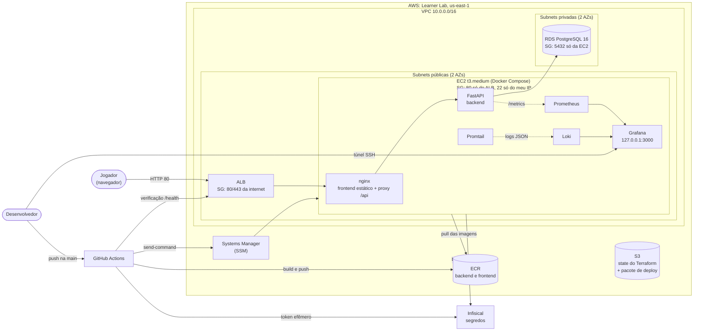
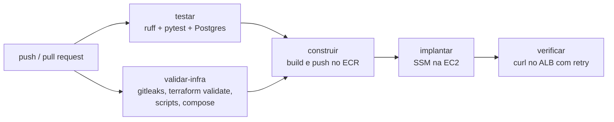

# Termo na nuvem: jogo de palavras com Terraform, CI/CD e observabilidade na AWS

Projeto Integrador **Desenvolvimento e Implantação em Nuvem** (Computação em Nuvem, UFRPE).
Uma aplicação web completa (jogo estilo Termo/Wordle) implantada na AWS por infraestrutura como código,
com pipeline de entrega contínua, gestão de segredos e observabilidade.

## Sumário

1. [Problema](#1-problema)
2. [Funcionalidades](#2-funcionalidades)
3. [Arquitetura](#3-arquitetura)
4. [Tecnologias e justificativas](#4-tecnologias-e-justificativas)
5. [Divisão de tarefas do grupo](#5-divisão-de-tarefas-do-grupo)
6. [Estrutura do repositório](#6-estrutura-do-repositório)
7. [Como executar localmente](#7-como-executar-localmente)
8. [Como implantar na AWS](#8-como-implantar-na-aws)
9. [CI/CD e como os testes bloqueiam o deploy](#9-cicd-e-como-os-testes-bloqueiam-o-deploy)
10. [Segredos com Infisical](#10-segredos-com-infisical)
11. [Medidas de segurança](#11-medidas-de-segurança)
12. [Observabilidade](#12-observabilidade)
13. [Como remover os recursos](#13-como-remover-os-recursos)
14. [Restrições do Learner Lab e decisões](#14-restrições-do-learner-lab-e-decisões)
15. [Custos](#15-custos)

---

## 1. Problema

Subir uma aplicação "de verdade" na nuvem exige mais do que escrever código: é preciso criar a rede e os
servidores de forma **reprodutível**, entregar novas versões **sem passos manuais**, **proteger segredos**
(senha do banco, chave de assinatura) e **enxergar o que acontece** em produção (métricas, logs, erros).

O jogo é o pretexto: ele é pequeno o bastante para o foco ficar na infraestrutura, na automação e na integração,
mas tem os ingredientes de um sistema real (API, banco relacional, autenticação, estado, regras de negócio
sensíveis a fraude).

## 2. Funcionalidades

**Jogo.** O jogador tem 6 tentativas para descobrir a palavra do dia (5 letras, português).

- A palavra fica **apenas no backend**; o cliente nunca a recebe, nem quando perde. O servidor avalia cada palpite
  e devolve o resultado por letra (`correta`, `presente`, `ausente`), tratando corretamente letras repetidas.
- Login simples por apelido (sem senha), com token JWT assinado.
- Uma partida por jogador por dia; ranking e estatísticas (vitórias, taxa de vitória, sequência, média de tentativas).

**API**

| Método e rota | Descrição |
|---|---|
| `GET /health` | Saúde da aplicação e do banco (usado pelo ALB e pelo pipeline) |
| `GET /metrics` | Métricas Prometheus (interno: o nginx e o ALB não o expõem) |
| `POST /api/jogadores` | Cria ou reentra como jogador; devolve o token |
| `POST /api/partidas` | Inicia (ou retoma) a partida do dia |
| `POST /api/partidas/{id}/palpites` | Envia um palpite e recebe a avaliação por letra |
| `GET /api/ranking` | Ranking por vitórias e média de tentativas |
| `GET /api/jogadores/{apelido}/estatisticas` | Estatísticas do jogador |

**Infraestrutura e plataforma:** VPC, ALB, EC2, RDS, ECR e S3 com Terraform; pipeline GitHub Actions;
segredos no Infisical; Prometheus, Grafana e Loki.

## 3. Arquitetura



**Fluxo do pipeline**



Decisões de rede importantes:

- **Sem NAT Gateway** (custo): a EC2 fica em subnet pública com IP público e a segurança vem dos *security groups*
  encadeados. O banco fica em subnets privadas, sem rota para a internet.
- **Security groups encadeados por referência** (não por CIDR): o SG da EC2 só aceita o SG do ALB; o SG do banco
  só aceita o SG da EC2.
- O ALB usa subnets públicas em **2 AZs**; o RDS usa um *subnet group* com 2 AZs privadas.

## 4. Tecnologias e justificativas

| Tecnologia | Por que foi escolhida |
|---|---|
| **Terraform** | Infraestrutura declarativa e versionada: recria o ambiente inteiro após cada sessão do lab. `plan` mostra o impacto antes de aplicar. Reaproveita o módulo `vpc` existente. |
| **Backend S3 com `use_lockfile`** | State compartilhado, criptografado e versionado, com lock no próprio bucket (dispensa DynamoDB). |
| **FastAPI + SQLAlchemy + Alembic** | API tipada e rápida de escrever; SQLAlchemy 2 isola o acesso ao banco; Alembic versiona o esquema e roda na subida do container. |
| **PostgreSQL no RDS** | Banco gerenciado (patches, disco criptografado) isolado em subnets privadas. Escolhido em vez de Postgres em container para não misturar dados com o host e não perdê-los ao recriar a EC2. |
| **nginx + HTML/CSS/JS puro** | Frontend sem etapa de build; nginx serve os estáticos, aplica cabeçalhos de segurança e faz proxy só de `/api` e `/health`. |
| **Docker + Docker Compose** | Mesmo artefato em desenvolvimento, CI e produção; Compose basta para 1 EC2 e é simples de entender. |
| **Amazon ECR** | Registro privado integrado ao IAM da AWS (a EC2 autentica com o perfil do lab, sem senha). |
| **ALB** | Ponto de entrada único com health check; permite a EC2 ficar sem porta pública própria. |
| **GitHub Actions** | CI/CD no próprio repositório, com jobs encadeados por `needs` e serviço Postgres para os testes de API. |
| **SSM `send-command` (deploy)** | Não exige abrir a porta 22 para IPs dinâmicos do GitHub (o SSH fica restrito ao meu IP). O agente já vem no Amazon Linux 2023 e foi validado com a `LabRole`. |
| **Infisical (Universal Auth)** | Cofre de segredos com identidade de máquina: o CI troca *client id/secret* por um token de vida curta. Nenhum segredo vai para o código. |
| **Prometheus** | Padrão de métricas; o histograma de latência permite p95 por rota. |
| **Loki + Promtail** | Logs estruturados em JSON indexados por poucos rótulos, baratos o bastante para uma instância pequena. |
| **Grafana** | Dashboards e datasources **provisionados por arquivo**, reproduzíveis e revisáveis no Git. |
| **gitleaks** | Barreira automática contra segredos no código e no histórico. |

## 5. Divisão de tarefas do grupo

> Preencher com os integrantes e as responsabilidades.

| Integrante | Responsabilidades |
|---|---|
| _Nome 1_ | _ex.: backend, testes_ |
| _Nome 2_ | _ex.: Terraform, rede_ |
| _Nome 3_ | _ex.: CI/CD, segredos_ |
| _Nome 4_ | _ex.: observabilidade, documentação_ |

## 6. Estrutura do repositório

```
.
├── app/
│   ├── backend/                 FastAPI, Alembic, testes (pytest) e Dockerfile
│   └── frontend/                HTML/CSS/JS puro, nginx.conf e Dockerfile
├── deploy/                      Pacote enviado à EC2 a cada deploy
│   ├── docker-compose.prod.yml            backend + frontend (imagens do ECR)
│   ├── docker-compose.observabilidade.yml Prometheus, Loki, Promtail, Grafana
│   ├── observabilidade/                   configs e dashboard provisionados
│   ├── implantar.sh                       roda na EC2: pull, segredos, up, rollback
│   └── buscar_segredos.py                 busca os segredos no Infisical (roda na EC2)
├── bootstrap/                   Terraform do bucket de state (state local)
├── modules/vpc/                 Módulo de rede (VPC, subnets, IGW, rotas)
├── *.tf                         Infra da aplicação: ALB, ECR, RDS, SGs, EC2, outputs
├── templates/user_data.sh.tftpl Provisionamento inicial da EC2
├── scripts/                     Automação (credenciais, init, deploy, verificação, destruição)
├── .github/workflows/ci-cd.yml  Pipeline
├── docker-compose.yml           Execução local
└── docs/                        Teoria (etapa 1) e checklist de requisitos
```

## 7. Como executar localmente

Pré-requisitos: Docker e Docker Compose. Nenhuma credencial da AWS é necessária.

```bash
cp .env.example .env            # ajuste os valores se quiser
docker compose up -d --build --wait
# abra http://localhost:8080
```

Com observabilidade (Prometheus em `:9090`, Grafana em `:3000`):

```bash
docker compose -f docker-compose.yml -f docker-compose.observabilidade.yml up -d --build --wait
# Grafana: http://localhost:3000  (usuário admin, senha = GRAFANA_ADMIN_PASSWORD do .env)
```

Testes do backend (Python 3.12):

```bash
cd app/backend
python -m venv .venv && source .venv/bin/activate   # no Windows: .venv\Scripts\activate
pip install -r requirements-dev.txt
docker compose -f compose.teste.yml up -d --wait    # PostgreSQL de teste na porta 5433
ruff check . && ruff format --check .
pytest
docker compose -f compose.teste.yml down
```

Os testes de API recusam rodar se `DB_NAME` não terminar em `_teste`, porque eles apagam as tabelas.

## 8. Como implantar na AWS

### 8.1 Credenciais do Learner Lab

1. No Learner Lab, clique em **Start Lab** e espere o indicador "AWS" ficar verde.
2. **AWS Details → AWS CLI: Show** e copie o bloco exibido.
3. Cole em `~/.aws/credentials` (perfil `[default]`). Se você já tem outros perfis, **não apague**: acrescente o bloco
   e use `AWS_PROFILE`.
4. Confira: `aws sts get-caller-identity` (a identidade deve conter `voclabs`).

As credenciais **expiram a cada sessão**. Para o pipeline, atualize os GitHub Secrets com o script:

```bash
./scripts/atualizar-secrets-aws.sh              # perfil default do ~/.aws/credentials
./scripts/atualizar-secrets-aws.sh --perfil lab # outro perfil
./scripts/atualizar-secrets-aws.sh --simular    # valida sem gravar nada
```

O script lê `~/.aws/credentials`, grava `AWS_ACCESS_KEY_ID`, `AWS_SECRET_ACCESS_KEY` e `AWS_SESSION_TOKEN` com
`gh secret set` (o valor passa por *stdin*, nunca aparece em argumentos nem no log) e **se recusa** a enviar um perfil
sem `aws_session_token` ou que não seja o do lab, para não publicar credenciais de outra conta.

> Repita esse passo a cada novo **Start Lab**, antes de dar push na `main`.

### 8.2 Primeira implantação (uma vez por conta do lab)

```bash
# 1. Bucket de state (versionado, criptografado, só TLS). Cria via CLI e configura via Terraform.
./scripts/criar-bucket-state.sh

# 2. Variáveis (arquivo ignorado pelo Git)
cp terraform.tfvars.example terraform.tfvars    # ajuste project_name e allowed_ssh_cidr (seu IP/32)

# 3. Inicializa o backend remoto apontando para o bucket da sua conta
./scripts/iniciar-terraform.sh

# 4. Planeja e aplica. A senha do banco vem do Infisical (ver seção 10); sem Infisical, use TF_VAR_db_password.
./scripts/terraform-com-infisical.sh plan  -out=plano.tfplan
./scripts/terraform-com-infisical.sh apply plano.tfplan
rm plano.tfplan                                  # o plano contém a senha do banco

# 5. Endereços
terraform output app_url
```

O Terraform cria 33 recursos (rede, security groups, ALB, ECR, RDS, EC2). O RDS leva de 5 a 10 minutos.

### 8.3 Implantar a aplicação

Basta dar **push na `main`**: o pipeline constrói as imagens, envia ao ECR, implanta na EC2 e verifica o resultado
(seção 9). Para implantar sem o GitHub, a partir da sua máquina com credenciais válidas:

```bash
# (build e push das imagens para o ECR, com a tag desejada)
./scripts/enviar-deploy.sh <tag-da-imagem>
./scripts/verificar-deploy.sh "$(terraform output -raw app_url)"
```

## 9. CI/CD e como os testes bloqueiam o deploy

O workflow [`.github/workflows/ci-cd.yml`](.github/workflows/ci-cd.yml) tem cinco jobs encadeados:

| Job | Depende de | O que faz |
|---|---|---|
| `testar` | (nenhum) | `ruff check`, `ruff format --check`, `node --check` do frontend e `pytest` com **PostgreSQL 16 como `service`** |
| `validar-infra` | (nenhum) | gitleaks (código e histórico), `terraform fmt` e `validate`, sintaxe dos scripts, `docker compose config` |
| `construir` | `testar`, `validar-infra` | build das imagens e push no ECR (tag = SHA do commit e `latest`) |
| `implantar` | `construir` | obtém o token no Infisical e dispara o deploy na EC2 via SSM |
| `verificar` | `implantar` | `curl` em `/health` e no fluxo de jogo pelo DNS do ALB, com retry e timeout |

**Como o resultado dos testes bloqueia o deploy.** Cada job declara `needs:` dos anteriores, e o GitHub Actions só
inicia um job quando **todos** os seus `needs` terminam com sucesso. Se um teste falhar, o job `testar` fica
vermelho, `construir` é marcado como *skipped* e **nenhuma imagem é publicada nem nenhum deploy acontece**.
O mesmo vale para uma falha de lint, de formatação, de `terraform validate` ou do gitleaks (job `validar-infra`).
Em *pull requests* rodam apenas `testar` e `validar-infra` (as etapas de build, deploy e verificação têm
`if: github.event_name != 'pull_request'`), e eles não têm acesso aos segredos do repositório.

**Verificação pós-deploy.** O script [`scripts/verificar-deploy.sh`](scripts/verificar-deploy.sh) tenta até 24 vezes
(10 s entre tentativas, timeout de 10 s por requisição) e exige: `/health` com banco ok; criação de jogador e do
token; partida criada com 6 tentativas e **sem** o campo `palavra`; um palpite avaliado letra a letra; ranking
em formato de lista; e `/metrics` **não** exposto pelo ALB. Qualquer falha termina com código 1 e derruba o job.

**Por que SSM e não SSH.** Para o GitHub alcançar a EC2 por SSH seria preciso abrir a porta 22 para IPs dinâmicos,
contradizendo "SSH restrito". O SSM não abre porta alguma; usa a `LabRole` da instância.

**Rollback automático.** O `implantar.sh` guarda a versão anterior; se a aplicação não ficar saudável em 150 s, ele
restaura a versão anterior e falha o job.

> Sugestão adicional: em *Settings → Branches*, proteja a `main` exigindo os checks `Lint e testes` e
> `Validar Terraform e scripts` antes do merge.

## 10. Segredos com Infisical

Os segredos gerenciados são `DB_PASSWORD`, `TOKEN_SECRET` (chave de assinatura do JWT) e `GRAFANA_ADMIN_PASSWORD`.
**Nada disso existe no código nem em arquivos versionados** (o gitleaks confere a cada execução).

### Como funciona

1. O job `implantar` autentica no Infisical com **Universal Auth** (`INFISICAL_CLIENT_ID` e
   `INFISICAL_CLIENT_SECRET` nos GitHub Secrets) e recebe um **token de acesso de vida curta**.
2. O token é registrado com `::add-mask::` e entregue à EC2 pelo SSM. **Os segredos em si não passam pelo SSM.**
3. Na EC2, [`buscar_segredos.py`](deploy/buscar_segredos.py) usa o token para ler os três segredos diretamente do
   Infisical, valida o formato e grava `/opt/termo/segredos.env` com permissão `600`. Os valores nunca são impressos.
4. Os contêineres leem esse arquivo; o token é descartado.

### Configuração (uma vez)

1. No Infisical, crie um projeto e, no ambiente `prod`, os três segredos acima. Use senhas fortes
   (por exemplo `python -c "import secrets;print(secrets.token_urlsafe(32))"`); a senha do banco aceita de 16 a 128
   caracteres, sem espaço e sem `/ @ " ' \`.
2. Em **Access Control → Machine Identities**, crie uma identidade com **Universal Auth**, defina o *Access Token TTL*
   curto (ex.: 300 s) e dê a ela acesso de **leitura** ao projeto.
3. No GitHub:

   ```bash
   gh secret set INFISICAL_CLIENT_ID          # cole o client id
   gh secret set INFISICAL_CLIENT_SECRET      # cole o client secret
   gh variable set INFISICAL_PROJECT_ID --body "<id do projeto>"
   gh variable set INFISICAL_ENV        --body "prod"
   # opcional, para instância própria/EU: gh variable set INFISICAL_URL --body "https://eu.infisical.com"
   ```

4. Para o Terraform, use a [Infisical CLI](https://infisical.com/docs/cli/overview) logada e o wrapper
   `INFISICAL_PROJECT_ID=<id> ./scripts/terraform-com-infisical.sh plan|apply|destroy`, que exporta
   `TF_VAR_db_password` só para o processo do Terraform.

Enquanto as credenciais do Infisical não estiverem configuradas, o deploy emite um **aviso** e reaproveita o
`segredos.env` que já existe na instância (útil na transição). Depois de configurar, a fonte passa a ser sempre o
Infisical (a saída do deploy mostra `Fonte dos segredos: Infisical`).

### Mascaramento em logs

- `::add-mask::` no token do Infisical e no token do jogador usado na verificação.
- Os GitHub Secrets são mascarados automaticamente pelo Actions.
- Os scripts passam valores sensíveis por *stdin* ou por variáveis de ambiente, nunca como argumento de comando visível.
- `buscar_segredos.py` informa só **quais chaves** foram lidas, nunca os valores.
- O repositório é **público**, portanto os logs do Actions também são: por isso nenhum passo imprime segredos.

### Aviso: segredos que vão parar no `tfstate`

A senha do banco (`aws_db_instance.password`) é gravada em **texto claro no `terraform.tfstate`**. Isso é inevitável
com o provider AWS. A mitigação adotada: o state fica em bucket S3 **privado, criptografado, versionado e com política
que nega acesso sem TLS**, e planos salvos (`*.tfplan`, que também contêm o valor) são ignorados pelo Git e devem ser
apagados após o uso. Quem tem acesso de leitura ao bucket de state enxerga a senha do banco.

## 11. Medidas de segurança

| Camada | Medida |
|---|---|
| Rede | Security groups encadeados: internet → ALB (80/443) → EC2 (80 só do ALB; 22 só do IP autorizado) → RDS (5432 só da EC2). Banco em subnets privadas, sem IP público. |
| Acesso administrativo | SSH restrito a um `/32` (a variável **recusa** `0.0.0.0/0`); deploy sem porta aberta, via SSM. |
| Metadados | EC2 com IMDSv2 obrigatório. |
| Dados | RDS e disco da EC2 criptografados; conexão ao banco com `sslmode=require`. |
| Aplicação | A palavra do dia **nunca** sai do backend (escolhida por HMAC da data com a chave secreta); tokens JWT assinados com expiração; entradas validadas (apelido, palpite). |
| Exposição | `/metrics` não é publicado pelo nginx/ALB; Grafana e Prometheus escutam só em `127.0.0.1` (acesso por túnel SSH). |
| Web | nginx com `Content-Security-Policy`, `X-Frame-Options: DENY`, `nosniff` e sem versão do servidor; contêiner do backend roda sem root. |
| Segredos | Infisical com Universal Auth e token efêmero; arquivo `600` na EC2; gitleaks no CI; `.gitignore` para `*.tfvars`, `*.tfstate`, `.env`, planos e chaves. |
| Credenciais AWS | O script de atualização valida a conta e recusa perfis sem token de sessão. Credenciais do lab são temporárias. |
| Supply chain | Versões fixadas (provider `~> 5.0`, imagens com tag, `requirements.txt` com versões exatas, checksum do Docker Compose). |
| Pipeline | PRs sem segredos; permissões mínimas do workflow (`contents: read`); *concurrency* no deploy. |

## 12. Observabilidade

Prometheus, Grafana, Loki e Promtail rodam em Docker Compose **na mesma EC2**, em contêineres com limite de memória.

### Métricas (Prometheus)

Expostas pelo backend em `/metrics` e coletadas a cada 15 s:

| Métrica | Tipo | Significado |
|---|---|---|
| `partidas_iniciadas_total` | contador | partidas criadas |
| `partidas_vencidas_total` | contador | partidas vencidas |
| `partidas_perdidas_total` | contador | partidas perdidas |
| `palpites_total` | contador | palpites avaliados |
| `http_requisicoes_total{metodo,rota,status}` | contador | requisições por rota e status |
| `http_requisicao_duracao_segundos{metodo,rota}` | histograma | latência por rota |

Os rótulos de rota usam o **padrão** da rota (`/api/partidas/{partida_id}/palpites`), não o caminho real, para evitar
cardinalidade explosiva.

### Logs (Loki)

Backend e nginx escrevem **logs JSON** (`timestamp`, `level`, `logger`, `message`, `rota`, `status`, `duracao_ms`,
`id_requisicao`...). O mesmo `id_requisicao` aparece no nginx e no backend. O Promtail lê os logs dos contêineres pela
API do Docker e envia ao Loki com os rótulos `service`, `container`, `level` e `logger`. Retenção: 72 horas.

### Dashboard (Grafana)

Provisionado por arquivo (`deploy/observabilidade/grafana/`): **Termo - Visão geral**, com taxa de vitória,
partidas iniciadas/vencidas/perdidas, palpites, requisições por segundo por rota, **latência p95** por rota, taxa de
erros 5xx, erros 4xx/5xx por status e painéis de logs (avisos e erros, requisições e acessos do nginx).

### Como acessar

Grafana e Prometheus **não são públicos**. Acesse por túnel SSH (a chave `labsuser.pem` vem em *AWS Details → Download PEM*):

```bash
$(terraform output -raw grafana_tunnel_command)
# equivale a: ssh -i labsuser.pem -L 3000:localhost:3000 ec2-user@<IP-DA-EC2>
# para abrir também o Prometheus, acrescente: -L 9090:localhost:9090
```

Com o túnel aberto: Grafana em <http://localhost:3000> (usuário `admin`; a senha é o segredo
`GRAFANA_ADMIN_PASSWORD` do Infisical) e, se tiver aberto a porta, Prometheus em <http://localhost:9090>.

## 13. Como remover os recursos

> Antes de encerrar a sessão do lab, destrua os recursos: eles continuam cobrando crédito mesmo com as credenciais
> expiradas, e você precisaria renovar as credenciais para destruí-los depois.

```bash
./scripts/destruir.sh                  # destrói a infraestrutura (mantém o bucket de state)
./scripts/destruir.sh --incluir-state  # idem e, depois, esvazia e apaga o bucket de state
./scripts/destruir.sh --sim            # sem confirmação interativa
```

O comando equivalente, direto no Terraform, é `terraform destroy` na raiz (com `TF_VAR_db_password` definida, pois a
variável é obrigatória). O script pede confirmação, usa o backend remoto e, com `--incluir-state`, remove **todas as
versões** do bucket (um bucket versionado não pode ser apagado enquanto tiver versões). O banco é destruído **sem
snapshot final**: os dados são perdidos.

## 14. Restrições do Learner Lab e decisões

| Restrição / descoberta | Como o projeto lida |
|---|---|
| Sem permissão para criar IAM | Usa `LabInstanceProfile` (LabRole) na EC2 e o `vockey` para SSH. |
| Credenciais temporárias | Nada de credenciais no código; `scripts/atualizar-secrets-aws.sh` renova os GitHub Secrets. |
| Só `us-east-1` e `us-west-2` | `aws_region` valida as duas opções. |
| Política da organização (SCP) nega `s3:GetBucketObjectLockConfiguration`, lida pelo recurso `aws_s3_bucket` | O bucket de state é criado pela CLI (`scripts/criar-bucket-state.sh`) e configurado pelo Terraform (versionamento, criptografia, bloqueio público, TLS-only e lifecycle) via *data source*. |
| Sem NAT Gateway (custo) | EC2 em subnet pública com IP público; o RDS não precisa de internet. |
| Bucket novo bloqueado pelo mesmo motivo | O pacote de deploy usa o prefixo `deploy/` do bucket de state. |
| HTTPS exigiria domínio e certificado | O SG já aceita 443, mas só há listener HTTP (80). Com um domínio, basta um certificado ACM e um listener 443. |

## 15. Custos

Com tudo de pé: cerca de **US$ 0,09 por hora** (EC2 `t3.medium`, RDS `db.t3.micro` e ALB), perto de US$ 2 por dia.
Não há NAT Gateway nem recursos ociosos. Destrua o ambiente (seção 13) quando não estiver usando.
